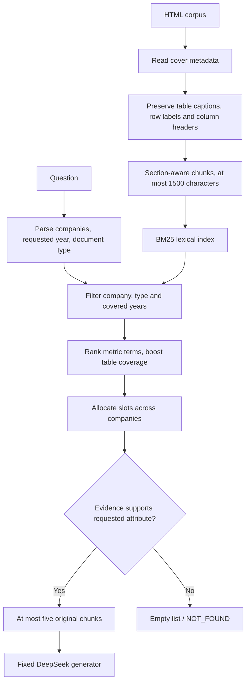

# FTEC5660 Homework 4

## Run

Python 3.10+:

```bash
python3 -m venv .venv
source .venv/bin/activate
pip install -r requirements.txt
# Create .env containing DEEPSEEK_API_KEY=your_key (never commit it).
python hw4.py --data-folder public_test
python ablation.py --generate
python write_report.py
```

`hw4.py` is the unmodified official runner/generator below the provided-code boundary. Only the five student functions and helpers above that boundary are changed. No embeddings, extra model clients, external retrieval sources, saved indices, answer lookup, or hard-coded company names are used. Retrieval itself requires zero LLM calls.

For offline diagnostics use `python check_offline.py` and `python ablation.py` (the latter leaves accuracy unmeasured). `experiments/*_results.csv` records each ablation's question-level results; `experiments/summary.json` holds measured aggregate metrics. Run `write_report.py` after experiments to refresh this table. Only a successful official generator run should be reported as end-to-end accuracy.

## Homework 4 solution



I parse company, document type and report year from each cover rather than opaque filenames. Table rows preserve their labels, each column header, original values and captions with units. Paragraphs and tables are split within sections, with repeated section/caption context and a strict 1,500-character limit. BM25 uses normalized lexical tokens, retaining numbers but removing question scaffolding. The query parser preserves unknown company names so that a near match does not silently resolve to a known issuer. Metadata filtering allows annual-report year t or t+1 for a question about year t; calls may contain next-year guidance, and research reports may contain forecasts two years ahead. Once the company is filtered, removing company tokens from the ranking query prevents short cover snippets from outranking financial evidence. A table receives five points per distinct matching content token. Comparison retrieval distributes slots round-robin across companies. Unknown issuers, uncovered years, and unsupported requested attributes produce an empty list. The final support check combines lexical coverage with stricter checks for a few general classes of undisclosed attributes. It uses no gold labels and no model calls.

### Ablation study

All rows use the same public set: 40 documents, 46 answerable and 14 unanswerable questions. B0 uses BeautifulSoup `get_text()`, RecursiveCharacterTextSplitter (1,500 characters, 200 overlap), required metadata, lowercase-whitespace BM25 over the full corpus, no filtering and no abstention. Each subsequent row changes one component. V4 adds query-driven metadata filtering; empty candidate pools are already possible there. V5 changes ranking query construction only. V6 adds table term-coverage scoring only. V7 changes slot allocation only. V8 adds the support-based abstention check only.

| Variant | Single change | Recall@5 | Kept | Rejected | Answer accuracy |
|---|---|---:|---:|---:|---:|
| B0 | Naive baseline | 37.0% | 100.0% | 0.0% | 48.3% |
| V1 | Serialize tables | 28.3% | 100.0% | 0.0% | 45.0% |
| V2 | Section-aware chunks | 13.0% | 100.0% | 0.0% | 33.3% |
| V3 | Normalize lexical tokens | 2.2% | 100.0% | 0.0% | 25.0% |
| V4 | Filter company/type/year | 28.3% | 100.0% | 71.4% | 45.0% |
| V5 | Remove company tokens | 91.3% | 100.0% | 71.4% | 93.3% |
| V6 | Boost table term coverage | 100.0% | 100.0% | 71.4% | 98.3% |
| V7 | Allocate slots per company | 100.0% | 100.0% | 71.4% | 100.0% |
| V8 | Reject unsupported queries | 100.0% | 100.0% | 100.0% | 100.0% |

Kept and rejected use answerable and unanswerable questions as separate denominators. Recall requires every necessary fact, including both sides of comparisons. Offline files deliberately have blank answer/correct columns; those are not generated answers.

### Final official run

The official public-set run answered all 60 questions correctly (100% accuracy); Tasks 1–4 total 75/75 on this set. Retrieval recall, query parsing, document checks, table checks and abstention all reached 100%. It used zero student-side LLM calls and 46 generator calls (62,448 input and 161 output tokens; the runner estimates USD 0.0095 using its built-in pricing). Runtime was 6.1 seconds. The final `results.csv` contains the actual API answers. These are public-set results, not a promised private-set score.

### Analysis and errors

Table serialization alone reduces raw recall (36.96% to 28.26%). The representation becomes more explicit but longer, changing chunk boundaries and term statistics; preserving labels does not guarantee good global retrieval. Section-aware chunking then reduces recall to 13.04%, and normalized tokens to 2.17%. The small cover and heading chunks match shared issuer words very strongly while exact metric evidence is diluted across longer tables. V4's company/type/year filters recover 28.26% recall and reject ten of fourteen unanswerable questions, but issuer terms still dominate ranking within the selected documents. Removing those terms in V5 raises recall to 91.30%. Table coverage boosting in V6 raises it to 100%, rescuing comparison questions about net/operating income where short heading-only passages had displaced the relevant statement. Balanced per-company allocation leaves public recall unchanged: global ranking already retained both sides after V6. Although recall is unchanged, V7 improves answer accuracy from 98.33% to 100%. V6 answers q023 incorrectly (Lumen Harbor Foods instead of Sablewood Retail), while V7 answers it correctly after changing context allocation/order. This is consistent with context affecting the generator, but one run does not establish a robust causal improvement. V8 rejects the remaining four undisclosed-metric questions while retaining all 46 answerable questions.

The four V5 errors are q004, q013, q031 and q037: the generator returns NOT_FOUND for comparisons because the retrieved evidence does not establish both requested figures. V6 corrects these with table coverage boosting. V7 already answers all fourteen unanswerable questions correctly through the fixed generator, so V8 does not improve end-to-end accuracy on this run; it instead prevents unnecessary generation and makes the retriever itself reject unsupported requests. Answer accuracy is 48.33%, 45.00%, 33.33%, 25.00%, 45.00%, 93.33%, 98.33%, 100% and 100% from B0 through V8.

The final offline checks preserve all scored cells in all twelve tables, and all forty documents pass the supplied metadata/coverage checks. All 180 query fields are correct on this public set. These public development results do not establish private-set performance. The company-name parser assumes English capitalized names and document covers with the supplied structure. Year filtering describes these templates, not arbitrary archives. The lexical support threshold (0.55) and the table boost (5) were chosen during public-set development without a separate validation split, so overfitting is a material limitation. A real undisclosed metric can share many terms with disclosed data, and an answerable paraphrase can have low lexical overlap. A generic clause-level answerability check and held-out evaluation would be useful future work. Accurate retrieval also cannot prove that the fixed generator will choose the right year, unit, or current officer; that must be evaluated separately with its actual API responses.

## Task 6: Reflection

*Prepared with AI assistance.*

Ten years from now, I would like to be someone whose judgment other people can trust. If capable agents make analysis, programming and execution widely available, producing impressive work will be easier. Choosing a worthwhile problem, treating people fairly and accepting responsibility for consequences will still require commitment. I want to use AI to extend that commitment rather than use it as an excuse to avoid it.

My ambition to understand business and technology would still matter, but its purpose would change. I would care less about being the fastest person to produce an answer and more about deciding whether the question deserves to be asked. In finance, an efficient decision can still distribute risk unfairly or make a fragile institution look successful. I want to understand assumptions, explain uncertainty and recognize whose interests a recommendation serves.

Beyond professional achievements, I would want to be known as a reliable friend, a patient listener and someone who keeps promises when there is little recognition for doing so. An agent can help me remember a birthday or organize support, but I remain responsible for paying attention and actually showing up. Relationships should not become another task I outsource for efficiency.

I would still be willing to struggle with learning, physical practice and difficult conversations. Having an AI solve a problem is different from developing the ability to notice when its solution is wrong. Working through a proof, debugging my own misunderstanding or learning to explain something simply can change how I think. Exercise and conversations also ask for presence and effort that cannot be replaced by an excellent result delivered on my behalf.

The qualities I hope to develop are intellectual honesty, empathy, courage and the ability to revise a belief without treating revision as defeat. Technical literacy will still help me ask precise questions and audit evidence. Experience working with people whose circumstances differ from mine will help me notice what a technically elegant solution leaves out.

If my value is no longer determined mainly by what I can do, I will define myself through the commitments I choose and the way I honor them. That definition should survive both an unusually productive week and a period when I cannot perform well. I do not need to be more useful than a machine to deserve dignity or to offer someone care.

Starting tomorrow, I can reserve a small block of time to attempt a difficult problem before asking an agent, write down the assumptions behind one important decision, and make time for one conversation without optimizing it. I can also ask whether each use of AI is helping me become the person I want to be, or merely helping me avoid the discomfort involved. The goal is not to reject assistance; it is to remain deliberate about what I practice, what I delegate and what I take responsibility for.
